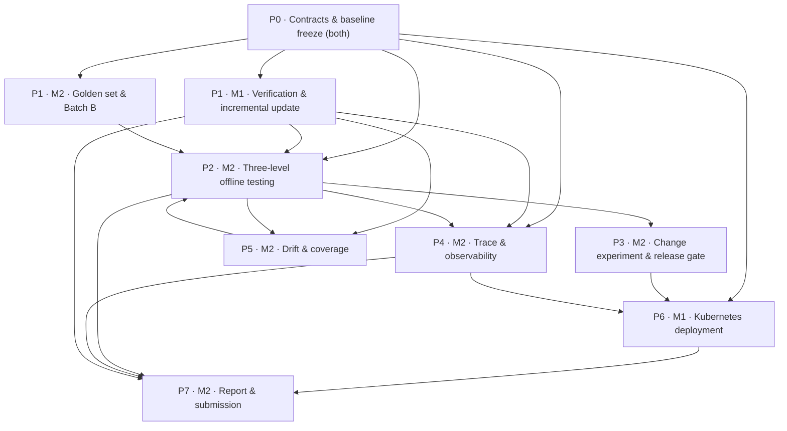

# RAGOps (Assignment 03) — 2-Day Implementation Plan for RAHBAR

**Team:** 2 members · **Duration:** 2 working days · **Base system:** RAHBAR from Assignment 02
**Reference:** Xu, Weytjens, Zhang, Lu, Weber, Zhu — *RAGOps: Operating and Managing Retrieval Augmented Generation Pipelines* (preprint, 2026)

This folder is the implementation plan for adding the RAGOps layer (Assignment 03) on top of the RAHBAR pipeline (Assignment 02). The plan is split into **one file per phase and per member**, plus a dependency map and the two day schedules.

---

## 1. How to read this folder

Each `PHASE_x_*.md` file is a self-contained work package: it states what will be implemented, which Assignment 03 item and paper section it serves, what it needs from earlier phases, the concrete tasks, the files touched, and the evidence that proves it is done.

Start with the phase chain, then open the file for the phase you are about to start.

---

## 2. Phase chain

---

## 3. File map

| File | Member | Day | What it implements |
|---|---|---|---|
| `README.md` | Both | — | This index and the phase chain |
| `PHASE_DEPENDENCY_MAP.md` | Both | — | Every input/output edge, sync gates, handoff checklists |
| `DAY_1_PLAN.md` | Both | Day 1 | Hour-by-hour Day 1 schedule and sync gates G0–G2 |
| `DAY_2_PLAN.md` | Both | Day 2 | Hour-by-hour Day 2 schedule and sync gates G3–G4 |
| `PHASE_0_CONTRACTS_AND_BASELINE.md` | Both | Day 1 09:00 | Trace schema, verification report, `golden.jsonl`, ConfigMap keys, frozen baseline |
| `PHASE_1_MEMBER_1_VERIFY_AND_UPDATE.md` | Member 1 | Day 1 | Part A: verification stage, quarantine, incremental update, archive/restore |
| `PHASE_1_MEMBER_2_GOLDEN_SET_AND_BATCH_B.md` | Member 2 | Day 1 | Part B golden set and Part A Batch B authoring |
| `PHASE_2_MEMBER_2_OFFLINE_TESTING.md` | Member 2 | Day 1 | Part B: module, component and end-to-end suites, stochasticity |
| `PHASE_3_MEMBER_2_CHANGE_AND_GATE.md` | Member 2 | Day 2 AM | Part C: one change, baseline vs candidate, release gate |
| `PHASE_4_MEMBER_2_TRACE_AND_OBSERVABILITY.md` | Member 2 | Day 1 PM → Day 2 AM | Part D: trace record, trace tool, metrics, guardrail log, root cause |
| `PHASE_5_MEMBER_2_DRIFT_AND_COVERAGE.md` | Member 2 | Day 2 PM | Part E: live queries, coverage, drift, close the gap |
| `PHASE_6_MEMBER_1_KUBERNETES.md` | Member 1 | Day 1 PM → Day 2 | Part F: Jobs, PVCs, ConfigMap thresholds, rollout/undo, resources |
| `PHASE_7_MEMBER_2_REPORT.md` | Member 2 | Day 2 PM | Part G: report tables, short answers, contribution, submission |

---

## 4. Roles

| Member | Role | Owns |
|---|---|---|
| **Member 1** | Platform, Data Infrastructure & Kubernetes Lead | Phase 1 (verify/update), Phase 6 (Kubernetes), trace volume plumbing |
| **Member 2** | AI Quality, Retrieval & Evaluation Lead | Phases 1b, 2, 3, 4, 5, 7 |
| **Both** | Shared | Phase 0 contracts, sync gates, evidence, final cluster run |

---

## 5. Non-negotiables

1. Kubernetes for the demo; Docker-only gets 0.
2. One writer to Chroma (the indexer Job); the API only reads.
3. Every number from your own runs; result files and traces committed.
4. Both members commit and can explain every part.
5. Contract-first: schemas agreed in Phase 0 before code.
6. Deploy by commit SHA, never `:latest`.

---

## 6. Related documents

- `Documents/Assignment 02, RAHBAR Grounded RAG on Kubernetes.md` — base system.
- `Documents/Assignment_03.md` — RAGOps task, Parts A–G.
- `Documents/RAGOps Operating and Managing Retrieval Augmented Generation Pipelinei.md` — paper.
- `Documents/phase_plans/COLLABORATION_ROADMAP.md` — Assignment 02 role split.
- `Documents/phase_plans/SIMILARITY_AND_DEPENDENCY_GUIDE.md` — Assignment 02 dependency matrix.
