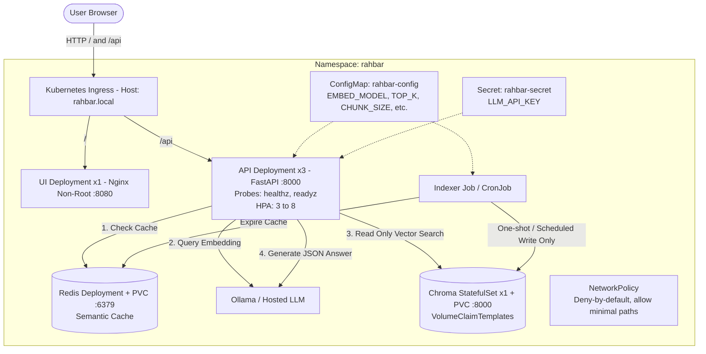

# RAHBAR Grounded RAG on Kubernetes — Master Collaboration Plan & Phase Roadmap

## 1. Project Overview & Architecture Blueprint
RAHBAR is an enterprise-grade, grounded question-answering system running on Kubernetes, strictly adhering to the fundamental RAG axiom:
> *"Indexing runs once, and again when the material changes; querying runs on every question."*

### System Architecture

---

## 2. Team Division of Roles (Strict Separation: ALL Docker with Member 1)

### **Member 1: Containers, Infrastructure, Platform & CI/CD Lead**
> **ALL Docker, containerization, and cluster deployment tasks belong exclusively to Member 1.**
- **All Docker Work:**
  - Authoring all 3 production Dockerfiles (`api/Dockerfile`, `indexer/Dockerfile`, `ui/Dockerfile` multi-stage non-root).
  - Authoring all `.dockerignore` files (`api/.dockerignore`, `indexer/.dockerignore`, `ui/.dockerignore`, and root `.dockerignore`).
  - Container builds, image tagging (`make images`, SHA tagging), and loading into Minikube/Kind (`minikube image load`).
  - Container vulnerability scanning with Trivy in CI.
  - Pushing images to Docker Hub in CD with commit SHA tags (`${{ github.sha }}`).
- **All Kubernetes Manifests & Infrastructure:**
  - Kustomize configuration (`k8s/base/` and overlays `k8s/overlays/{dev,prod}`).
  - Objects: `Namespace`, `Deployment` (api, ui, redis), `StatefulSet` (chroma with volumeClaimTemplates), `Job` (indexer), `CronJob` (reindex), `Service` (ClusterIP x 4), `Ingress`, `ConfigMap`, `Secret`, `NetworkPolicy` (deny-by-default), and `HorizontalPodAutoscaler`.
  - Probes tuning (`/healthz`, `/readyz`), resource limits, non-root security contexts.
- **Data Pipeline Engine & Storage:**
  - Completing `indexer/pipeline/` (`extract.py` with OCR, `clean.py`, `chunk.py` with overlap, `embed.py`, `store.py` writing vector embeddings and collection metadata).
  - Redis Semantic Cache implementation and re-indexing invalidation.
- **GitHub Actions Workflows:**
  - `.github/workflows/ci.yml` and `.github/workflows/cd.yml` with Kind ephemeral cluster.

---

### **Member 2: AI/ML Engineering, Retrieval Logic, Evaluation & Documentation Lead**
> **Zero Docker dependencies. Member 2 focuses purely on data curation, RAG services, LLM generation, quality gates, and architectural governance.**
- **Corpus Curation & Integrity:**
  - Discovering and downloading university documents matching all 7 required properties using `corpus/fetch.py`.
  - Generating and verifying `corpus/MANIFEST.md` with URLs and SHA-256 checksums.
  - Documenting all corpus properties and failure mode mapping in `docs/CORPUS.md`.
- **API Retrieval Engine & LLM Generation:**
  - Implementing `api/app/retrieval/chroma.py` with metadata filtering for `superseded: False`.
  - Pluggable LLM Providers (`ollama.py`, `hosted.py`, `stub.py`) with strict JSON mode enforcement.
  - Prompt construction with untrusted context delimitation against prompt injection.
  - Pydantic schema validation for `Answer`, 1-retry logic, and safe fallback.
- **Reliability & Guardrails:**
  - In-code Embedding Pin verification logic against Chroma metadata in `/readyz`.
  - Citation integrity verification (asserting 100% of citations match retrieved chunks).
  - Honest abstention logic (`answered_from_context: false`) and relevance floor filtering.
  - Prometheus metrics instrumentation (`/metrics`) and JSON logging with `request_id`.
- **Evaluation & Quality Assurance:**
  - Designing the Golden Dataset (`eval/golden.yaml` with $\ge 15$ questions across 5 categories).
  - Implementing the evaluation runner `eval/run_eval.py` (recall@k, citation validity, abstention correctness 100%, and regression CI gate).
  - Recording `eval/baseline.json` and `eval/results.json`.
- **Architectural Documentation & Analysis:**
  - Authoring 4 ADRs (`docs/adr/0001-indexer-as-job.md` to `0004-llm-provider-and-data-governance.md`).
  - Conducting deliberate failure injection experiments across 4 stages in `docs/FAILURE-ANALYSIS.md`.
  - Answering all 7 questions in `docs/ENGINEERING-NOTES.md` referencing exact code lines.
  - Completing `docs/AI-USAGE.md` and repository `README.md`.

---

## 3. Five-Phase Timeline

| Phase | Days | Focus Area | Member 1 Focus (Docker & Platform) | Member 2 Focus (AI, Data & Governance) | Sync Gate |
|---|---|---|---|---|---|
| **Phase 1** | Days 1–2 (Mon–Tue) | Foundation & Baseline Deployment | All 3 Dockerfiles, .dockerignore files, K8s manifests base, local cluster, run dummy indexer | Corpus acquisition (7 properties), MANIFEST.md, sources.yaml, ADR-0001 | Cluster runs stubs; check_submission passes Section 0, A, B, G |
| **Phase 2** | Days 3–4 (Wed–Thu) | Core Pipelines: Indexer & Retrieval | Complete indexer pipeline (Extract + OCR, Clean, Chunk with overlap, Embed, Store) | API ChromaRetriever, LLM Providers, superseded filter, Pydantic contracts | Real documents indexed to Chroma; API answers questions with citations |
| **Phase 3** | Day 5 (Fri) | Semantic Cache, Probes & Guardrails | Redis semantic cache, cache invalidation, network policies, HPA, rolling update settings | Embedding pin guardrail, /readyz deep checks, citation validator, abstention logic | Pin mismatch blocks readiness; semantic cache speeds repeated queries |
| **Phase 4** | Day 6 (Sat) | Evaluation, Chaos & CI/CD | GitHub Actions (ci.yml, cd.yml, Kind cluster, Trivy scan, Docker Hub push) | Golden set (15+ questions), eval/run_eval.py, baseline.json, Failure Analysis (4 stages) | CI passes full suite and eval gate on fixture corpus |
| **Phase 5** | Day 7 (Sun) | Polish, Evidence & Submission | kubectl top profiling, screenshots, rollout undo evidence, repo hygiene | ADRs 0002-0004, ENGINEERING-NOTES.md, AI-USAGE.md, README.md | `python scripts/check_submission.py` returns 0 failures; git history balanced |

---

## 4. Phase-by-Phase File Map
The individual execution guides are split into dedicated markdown documents:
1. `PHASE_1_MEMBER_1_DOCKER_AND_INFRA.md` *(Member 1 - All Dockerfiles & Manifests)*
2. `PHASE_1_MEMBER_2_CORPUS_DATA_ADR.md` *(Member 2 - Corpus, 7 Properties & ADR-0001)*
3. `PHASE_2_MEMBER_1_INDEXER_PIPELINE.md` *(Member 1 - 5-Stage Indexer Engine & Storage)*
4. `PHASE_2_MEMBER_2_API_RETRIEVAL_LLM.md` *(Member 2 - Chroma Retrieval & LLM Generation)*
5. `PHASE_3_MEMBER_1_CACHE_PROBES_GUARDRAILS.md` *(Member 1 - Redis Cache, NetworkPolicy & Probes)*
6. `PHASE_3_MEMBER_2_METRICS_LOGGING_FALLBACKS.md` *(Member 2 - Embedding Pin Guardrail & Observability)*
7. `PHASE_4_MEMBER_1_CICD_AUTOMATION.md` *(Member 1 - CI/CD Workflows, Trivy & Docker Hub)*
8. `PHASE_4_MEMBER_2_EVAL_GOLDEN_GATE.md` *(Member 2 - Golden Set, Eval Gate & Failure Analysis)*
9. `PHASE_5_MEMBER_1_FAILURE_ANALYSIS_EVIDENCE.md` *(Member 1 - Cluster Resource Profiling & Evidence)*
10. `PHASE_5_MEMBER_2_ADRS_ENGINEERING_NOTES.md` *(Member 2 - ADRs 2-4, Engineering Notes & Final Audit)*
11. `SIMILARITY_AND_DEPENDENCY_GUIDE.md` *(Both Members - Work Similarities & Inter-Member Blocking Dependencies)*
