# Work Similarity & Inter-Member Dependency Guide

This document maps out **work similarities** (areas with shared patterns, symmetrical code, or parallel responsibilities) and **work dependencies** (where one member's deliverable directly gates or unblocks the other).

---

## 1. Work Similarities (Symmetric Concepts & Parallel Work)

These areas do not conflict in code, but they follow identical conceptual models or share the same configurations and libraries. Both members must stay aligned on these standards.

```mermaid
flowchart TD
    subgraph ParallelEmbedding["1. Symmetric Embedding Logic"]
        M1_Embed["Member 1: indexer/pipeline/embed.py\nVectorizes document chunks in batches\nPinned model: nomic-embed-text"]
        M2_Embed["Member 2: api/app/retrieval/chroma.py\nVectorizes user query text\nPinned model: nomic-embed-text"]
        M1_Embed <-->|Must match dimension 768 & model pin| M2_Embed
    end

    subgraph ParallelChroma["2. Symmetrical ChromaDB Access"]
        M1_Store["Member 1: indexer/pipeline/store.py\nWrites embeddings & metadata via HttpClient\nRecords embed_model pin"]
        M2_Retr["Member 2: api/app/retrieval/chroma.py\nReads embeddings & queries top_k via HttpClient\nFilters on superseded metadata"]
        M1_Store <-->|Shared Collection: rahbar & Port: 8000| M2_Retr
    end

    subgraph ParallelSchema["3. Mirrored Data Contracts"]
        M1_Chunk["Member 1: Chunk Model\nsource, section, page, doc_version, superseded"]
        M2_Cite["Member 2: RetrievedRef & Citation\nsource, section, page"]
        M1_Chunk <-->|Field names must match 1:1| M2_Cite
    end
```



### Detailed Breakdown of Similarities

| Area | Member 1 Component | Member 2 Component | What is Similar & Must Align |
|---|---|---|---|
| **Vector Embedding** | `indexer/pipeline/embed.py` | `api/app/retrieval/chroma.py` | Both call the same embedding endpoint (`OLLAMA_URL` or hosted) using the exact same `EMBED_MODEL` (`nomic-embed-text`) with dimension 768. If they drift, retrieval produces silent garbage. |
| **ChromaDB Client** | `indexer/pipeline/store.py` (Write-only) | `api/app/retrieval/chroma.py` (Read-only) | Both use `chromadb-client==1.0.12` and connect to `http://chroma:8000` targeting collection `rahbar`. One writes vectors, the other queries them. |
| **Metadata Contracts** | `Chunk.metadata` dictionary | `RetrievedRef` and `Citation` schemas | The fields `source`, `section`, and `page` must be named and formatted identically so Member 2's citation verifier can match citations back to chunks. |
| **Probes & Endpoints** | K8s Probes in `api-deployment.yaml` | FastAPI Handlers in `routes/health.py` | Member 1 configures the probe triggers (`periodSeconds`, `failureThreshold`), while Member 2 writes the status code response logic (`200` vs `503`). |
| **Verification Tooling** | `kubeconform`, `trivy` container scanning | `ruff`, `mypy`, `pytest`, `run_eval.py` | Both members implement automated gating checks that catch mechanical failures before they hit the live cluster. |

---

## 2. Work Dependencies (Blocking Prerequisites & Handoffs)

Dependencies define **who must finish what before the other can proceed**. If an upstream task is delayed, the downstream task is blocked.

```mermaid
flowchart TD
    subgraph Phase1["Phase 1 Dependencies"]
        M2_Corp["Member 2: Fetch Corpus & MANIFEST.md"] -->|Real PDFs ready| M1_Extract["Member 1: Test extract.py & OCR"]
        M1_Dock["Member 1: Build Docker Images & Load to K8s"] -->|Images ready| M2_K8sTest["Member 2: Test API endpoints on Minikube"]
        M2_ADR1["Member 2: Write ADR-0001 (Indexer as Job)"] -->|Architectural contract| M1_Job["Member 1: Author indexer-job.yaml"]
    end

    subgraph Phase2["Phase 2 Dependencies"]
        M1_StorePin["Member 1: store.py records embed_model in Chroma"] -->|Collection metadata| M2_PinGuard["Member 2: readyz checks model pin"]
        M1_IndexerRun["Member 1: Index real chunks into Chroma"] -->|Vector data populated| M2_ChromaRetr["Member 2: Test ChromaRetriever & Generation"]
    end

    subgraph Phase3["Phase 3 Dependencies"]
        M1_Reindex["Member 1: Indexer Job runs re-index"] -->|Flush cache signal| M1_Redis["Member 1: Invalidate Redis Cache"]
        M1_Redis -->|Fresh cache state| M2_ApiCache["Member 2: API serves updated answers"]
    end

    subgraph Phase4["Phase 4 Dependencies"]
        M2_Golden["Member 2: golden.yaml & run_eval.py"] -->|Evaluation Gate| M1_CI["Member 1: ci.yml e2e Kind Job"]
        M1_CI -->|CI passing + test passing| M1_CD["Member 1: cd.yml push to Docker Hub"]
    end

    subgraph Phase5["Phase 5 Dependencies"]
        M1_Top["Member 1: Run kubectl top on Indexer & API"] -->|Memory & CPU numbers| M2_Notes["Member 2: docs/ENGINEERING-NOTES.md (Q3 & Q4)"]
        M1_ChunkStats["Member 1: Measure 3 Chunking (Size, Overlap) Configs"] -->|recall@5 & amplification table| M2_Pipe["Member 2: docs/PIPELINE.md & ADR-0002"]
        M1_Undo["Member 1: Demonstrate kubectl rollout undo"] -->|Evidence files in docs/evidence/| M2_Audit["Member 2: Run scripts/check_submission.py"]
    end
```

---

## 3. Comprehensive Dependency Matrix

| # | Upstream Task (Producer) | Owner | Downstream Task (Consumer) | Owner | Impact if Blocked / Workaround |
|---|---|---|---|---|---|
| **D1** | **Corpus Fetch & Verify**<br>(`corpus/MANIFEST.md`) | **Member 2** | **PDF Extraction & OCR**<br>(`indexer/pipeline/extract.py`) | **Member 1** | *Workaround:* Member 1 uses `eval/fixtures/` and dummy mode while Member 2 downloads and verifies the 6+ documents. |
| **D2** | **All Docker Builds**<br>(`api/Dockerfile`, `indexer/Dockerfile`) | **Member 1** | **Cluster Integration Testing**<br>(Minikube deployment) | **Member 2** | *Workaround:* Member 2 tests API retrieval and LLM logic locally using `make dev` and stubs before testing in-cluster. |
| **D3** | **Indexer Metadata Pinning**<br>(`store.py` records `embed_model`) | **Member 1** | **Embedding Pin Guardrail**<br>(`api/app/routes/health.py` `/readyz`) | **Member 2** | If Member 1 omits `embed_model` from Chroma collection metadata, `/readyz` will report 503 error forever. |
| **D4** | **Indexer Chroma Persistence**<br>(`python -m pipeline.run`) | **Member 1** | **Real Query Retrieval & Answers**<br>(`api/app/retrieval/chroma.py`) | **Member 2** | Without indexed chunks, Chroma queries return empty lists, triggering honest abstention for all questions. |
| **D5** | **Cache Invalidation Mechanism**<br>(Trigger on Indexer run) | **Member 1** | **Cache Invalidation Verification**<br>(Never serve stale answers) | **Member 2** | Member 1 must provide the trigger (Redis key expiration or generation ID) so Member 2's query pipeline knows when cache is invalidated. |
| **D6** | **Evaluation Harness & Golden Set**<br>(`eval/run_eval.py`, `eval/golden.yaml`) | **Member 2** | **CI E2E Kind Workflow**<br>(`.github/workflows/ci.yml`) | **Member 1** | Member 1 cannot complete `ci.yml` until Member 2's `run_eval.py` exits 0 on valid fixtures and exits 1 on regression. |
| **D7** | **Chunking Experiments & Profiling**<br>(Run 3 size/overlap setups) | **Member 1** | **Pipeline Docs & ADR-0002**<br>(`docs/PIPELINE.md`, `ADR-0002`) | **Member 2** | Member 2 cannot complete the mandatory table in `PIPELINE.md` without Member 1's real measured recall@5 and amplification ratios. |
| **D8** | **Cluster Resource Profiling**<br>(`kubectl top` on Indexer & API) | **Member 1** | **Engineering Notes (Q3, Q4)**<br>(`docs/ENGINEERING-NOTES.md`) | **Member 2** | Section 7 questions 3 and 4 explicitly require referencing real `kubectl top` command output, which Member 1 gathers. |

---

## 4. Synchronization Protocol (How to Work Without Getting Blocked)

To avoid idling while waiting for the other member, follow this **Contract-First Protocol**:

1. **Agree on Schemas First (Day 1)**:
   - Metadata keys: `source` (str), `section` (str), `page` (int), `doc_version` (str), `superseded` (bool).
   - Embedding pin key in collection metadata: `"embed_model"`.
   - Redis cache key format: `rahbar:query:<sha256(normalized_query)>`.

2. **Develop in Isolation Using Stubs**:
   - While Member 1 builds Dockerfiles and manifests, Member 1 uses `--dummy` indexer and starter stubs.
   - While Member 2 writes retrieval and LLM logic, Member 2 runs locally with `uvicorn` and the fixture corpus.

3. **Scheduled Daily Syncs**:
   - **Sync 1 (End of Phase 1)**: Member 1 loads Docker images into Minikube; Member 2 verifies `corpus/MANIFEST.md` and ADR-0001.
   - **Sync 2 (End of Phase 2)**: Member 1 indexes real documents into Chroma; Member 2 connects `ChromaRetriever` and asks questions through the API.
   - **Sync 3 (End of Phase 3)**: Verify `/readyz` fails when `EMBED_MODEL` is tampered with in ConfigMap (verifies pin guardrail).
   - **Sync 4 (End of Phase 4)**: Run `ci.yml` on a test branch; intentionally break a fixture question to verify the merge button turns grey (blocked PR evidence).
   - **Sync 5 (End of Phase 5)**: Run `python scripts/check_submission.py` together and confirm 0 failures.
