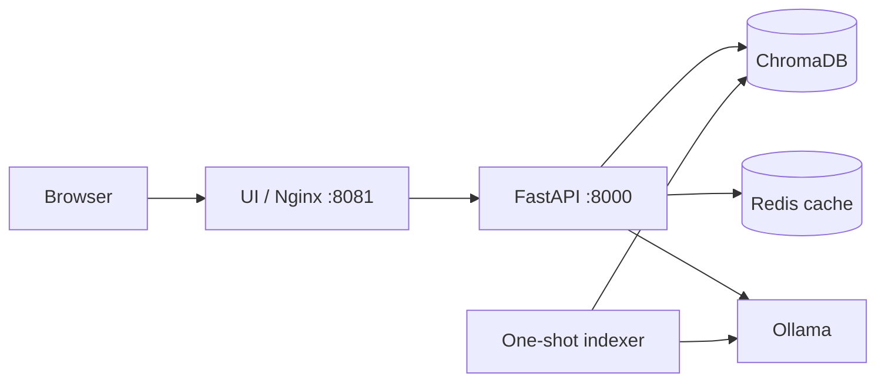

# RAHBAR

[](https://github.com/tawassulAkbr/rahbar-starter/actions)

RAHBAR is a grounded question-answering service for university policy documents. It retrieves passages from ChromaDB, asks Ollama for a structured answer, and returns citations from the retrieved source. If the indexed corpus does not support an answer, the API abstains.

## Runtime architecture

The live stack is composed of:

- **UI**: static chat page served by unprivileged Nginx on port `8081`.
- **API**: FastAPI on port `8000`; exposes health, readiness, metrics, and `/api/ask`.
- **ChromaDB**: persistent vector store on port `8000` inside the stack.
- **Ollama**: real embedding and generation service. The stack pulls `nomic-embed-text` and `llama3.2:3b` on first start.
- **Indexer**: one-shot job that extracts the corpus, creates embeddings, and writes the `rahbar` collection.
- **Redis**: semantic response cache and index-generation invalidation.

The API never indexes documents during startup. The indexer must finish before the API is started, and `/readyz` checks Chroma, the non-empty collection, the embedding pin, and Redis.



## Requirements

For the live stack install Docker Desktop with Compose v2. The first live start downloads the Ollama models and can take several minutes; allow at least 8 GB of available memory. Python 3.12+, `kubectl`, and Minikube are needed only for development-cluster deployment. GitHub Actions uses Ubuntu, Docker, and Kind.

## Run the real stack with Docker Compose

Run from the repository root:

```bash
docker compose up --build -d
docker compose ps
curl --fail http://localhost:8000/healthz
curl --fail http://localhost:8000/readyz
curl --fail http://localhost:8081/api/ask \
  -H 'Content-Type: application/json' \
  -d '{"question":"What CGPA puts a student on an academic warning?"}' | python -m json.tool
```

Open <http://localhost:8081> for the UI. The browser uses the Nginx `/api` proxy, so no CORS setup is required. Equivalent Make targets are:

```bash
make live-up
make live-status
make live-ask Q="What CGPA puts a student on an academic warning?"
make live-down
```

PowerShell users can use the same Docker commands. For direct API checks:

```powershell
Invoke-RestMethod http://localhost:8000/healthz
Invoke-RestMethod http://localhost:8000/readyz
$body = @{ question = "What CGPA puts a student on an academic warning?" } | ConvertTo-Json
Invoke-RestMethod http://localhost:8081/api/ask -Method Post -ContentType application/json -Body $body | ConvertTo-Json -Depth 8
```

`docker compose down` keeps named data volumes. To rebuild the index, remove the stack and its volumes, then start it again:

```bash
docker compose down -v
docker compose up --build -d
```

## Offline development mode

The offline mode is intentionally deterministic. It uses the corpus-backed retriever and provider stubs, so it does not prove that Chroma or Ollama is working. Use it for fast UI and unit-test iteration:

```bash
python3.12 -m venv .venv
source .venv/bin/activate                 # PowerShell: .venv\\Scripts\\Activate.ps1
python -m pip install --upgrade pip
python -m pip install -r api/requirements-dev.txt -r indexer/requirements-dev.txt
make dev
```

Open <http://localhost:8000>. The live Compose commands above are the required path when validating real retrieval and generation.

## Kubernetes development deployment

The manifests use Kustomize. Start Minikube with a CNI that enforces network policies, build the images, load them, and apply the dev overlay:

```bash
minikube start --driver=docker --cni=calico --memory=6144 --cpus=4
minikube addons enable metrics-server
minikube addons enable ingress

docker build -t rahbar-api:dev api
docker build -f indexer/Dockerfile -t rahbar-indexer:dev .
docker build -t rahbar-ui:dev ui
minikube image load rahbar-api:dev rahbar-indexer:dev rahbar-ui:dev

kubectl apply -k k8s/overlays/dev
kubectl rollout status statefulset/chroma -n rahbar --timeout=180s
kubectl rollout status deployment/redis -n rahbar --timeout=120s
kubectl wait --for=condition=complete job/indexer-job -n rahbar --timeout=600s
kubectl rollout status deployment/api -n rahbar --timeout=180s
kubectl rollout status deployment/ui -n rahbar --timeout=180s
```

The `dev` overlay is a cluster smoke-test configuration. The `prod` overlay deploys Ollama in-cluster as a single Deployment with a 20Gi PVC mounted at `/root/.ollama`. On first startup it downloads `nomic-embed-text` and `llama3.2:3b`; the Ollama startup probe allows up to ten minutes for server startup and model initialization. The API and indexer use the in-cluster `http://ollama:11434` Service. Build and load the API, indexer, and UI images with the `prod` tag before applying this overlay. Do not use the CI embedding stub as a production model.

## Corpus and indexing

The corpus source list and SHA-256 manifest are under `corpus/`; the nine university source files are downloaded locally by `corpus/fetch.py` and are not committed. Review `corpus/sources.yaml` before refreshing them:

```bash
python corpus/fetch.py
python corpus/fetch.py --verify
```

In Compose, the indexer runs automatically after the model and storage health checks. In Kubernetes, run a reindex job from the CronJob template:

```bash
kubectl create job --from=cronjob/reindex manual-reindex-1 -n rahbar
kubectl logs -f job/manual-reindex-1 -n rahbar
```

The API and indexer must use the same `EMBED_MODEL`, `EMBED_DIMENSION`, Chroma collection, and Ollama endpoint. Changing the embedding model requires rebuilding the entire collection.

## API

| Method | Path | Purpose |
|---|---|---|
| GET | `/healthz` | Liveness; does not require dependencies |
| GET | `/readyz` | Dependency and embedding-pin readiness |
| GET | `/metrics` | Prometheus metrics |
| POST | `/api/ask` | Grounded answer for `{"question":"..."}` |

Example response fields include `answer`, `citations`, `answered_from_context`, `confidence`, `provider`, and `retrieved`. The provider is `ollama` in the live stack and `stub` only in offline mode or CI tests.

## Verification

Run the local quality gates from the repository root:

```bash
python -m pytest -q
ruff check api indexer eval corpus
python -m mypy api/app indexer/pipeline
python -m compileall -q api indexer corpus
python scripts/check_submission.py
git diff --check
```

For an actual running deployment, also require:

```bash
curl --fail http://localhost:8000/readyz
python eval/run_eval.py --api http://localhost:8000
```

The evaluation must not use `--allow-stub` when validating the live Compose or production deployment.

## End-to-end workflow

Use this sequence when verifying a change from source document to grounded answer:

1. Review or refresh the checked-in corpus with `python corpus/fetch.py --verify`.
2. Start the real dependencies and index the corpus with `docker compose up --build -d`.
3. Confirm liveness and readiness with `/healthz` and `/readyz`; readiness must report a non-empty Chroma collection and matching embedding settings.
4. Ask through the UI proxy or API and inspect the returned citations and `answered_from_context` flag.
5. Run `python eval/run_eval.py --api http://localhost:8000 --request-timeout 600` without `--allow-stub` when using CPU-only Ollama; the default per-question timeout is 120 seconds.
6. Inspect `eval/results.json`, then stop the stack with `docker compose down` when finished.

The evaluator reports RAG answer precision through three safety measures: recall@3 and
recall@5 for expected passages, citation validity for citations matching retrieved
passages, and abstention correctness for unsupported or prompt-injection questions.
The committed `eval/results.json` is the 17-question live Compose evaluation generated
on 2026-11-11 with Chroma retrieval and Ollama generation (no `--allow-stub`). It reports
recall@3 `0.20`, recall@5 `0.20`, citation validity `1.00`, and abstention correctness
`2/2`; the regression gate failed because recall@5 is below the `1.00` baseline. This
is genuine live evidence and shows retrieval quality needs work. The deterministic CI
fixture results remain in `eval/fixtures/` and do not represent live quality.

## CI/CD workflow

`.github/workflows/ci.yml` runs tests, coverage, linting, type checks, compilation, manifest validation, and security checks. `.github/workflows/cd.yml` runs the test gate, builds the API/indexer/UI images, and deploys the CD overlay to an ephemeral Kind cluster. The CD overlay uses deterministic fixture embeddings and the stub generation provider so that GitHub Actions does not depend on downloading an LLM; it still verifies real Chroma indexing, API readiness, rollouts, and health endpoints. The Docker Compose path above is the repeatable real Ollama verification path.

For deployment details and required Docker Hub secrets, see [`docs/CI-CD.md`](docs/CI-CD.md). For system design, see [`docs/ARCHITECTURE.md`](docs/ARCHITECTURE.md); for the indexing pipeline, see [`docs/PIPELINE.md`](docs/PIPELINE.md).

## Configuration

The main runtime settings are supplied through environment variables and are defined in `api/app/config.py` and `indexer/pipeline/config.py`. Important values are `RETRIEVER`, `LLM_PROVIDER`, `OLLAMA_URL`, `LLM_MODEL`, `EMBED_MODEL`, `EMBED_DIMENSION`, `CHROMA_HOST`, `CHROMA_COLLECTION`, `REDIS_URL`, and `CORPUS_DIR`. Secrets such as hosted-provider API keys must be supplied through a Kubernetes Secret or the environment; do not commit them.

## Assignment verification status

The assignment submission checker currently reports **166 passed, 2 warnings, and 0 mechanical failures**. The warnings concern Git history authorship distribution and the committed placeholder Secret manifest; neither is an implementation failure, but review both before submission. The checker is a static lint and does not establish live retrieval quality or satisfy the manual deployment and evidence requirements.

The committed `eval/results.json` is a live Ollama/Chroma run, not a stub report. It scored recall@5 `0.20` against a `1.00` baseline and failed the evaluation gate. Citation validity was `1.00` and both must-abstain questions were correct, but retrieval did not reliably surface expected passages. Treat the run as evidence of a live quality gap, not as a passing production-quality claim; rerun after retrieval changes.

### Remaining submission checks

- Capture genuine GitHub branch-protection and failed/passing evaluation-gate evidence; the evidence README documents the missing branch-protection screenshot.
- Confirm a successful `cd.yml` run has published and deployed the commit-SHA images, then submit its link with the repository URL.
- Recheck source downloads and OCR on the deployment environment; the old 2023 policy PDF is scanned, and host OCR availability is environment-dependent.
- Review the two checker warnings and confirm the protected-branch rules are active on GitHub.
